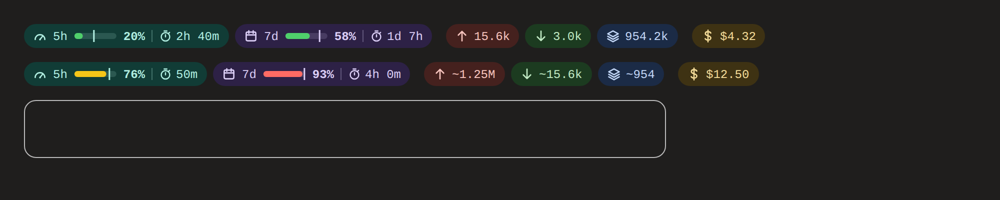

# usage-band

Claude Code'un mesaj kutusunun hemen üstünde duran bir kullanım şeridi. Bir **mod** olarak yazıldı (function hooks eklentisi).




| Hap | Ne gösterir |
|---|---|
| **5h** | 5 saatlik limitin doluluğu, sıfırlanmaya kalan süre (`2h 40m`) |
| **7d** | 7 günlük limitin doluluğu, kalan süre (`1d 7h`) |
| ↑ | giriş token'ı: önbelleksiz giriş + önbelleğe yazılan |
| ↓ | çıkış token'ı |
| katman | önbellekten okunan token |
| $ | oturum maliyeti (API liste fiyatıyla) |

Çubuktaki dikey çizgi pencerenin ne kadarının geçtiğini gösterir (`1 − kalan / pencere`). Çubuk %70'in altında yeşil, %70'ten itibaren sarı, %90'dan itibaren kırmızıdır. Bir hapın üzerine gelince döküm, bağlam doluluğu ve istek sayısı görünür.

## Veri nereden geliyor

- **Limit, bağlam, maliyet:** `$.session.usage()` ve her tur sonundaki `session.measure` olayı. Limit hapları ilk model yanıtından sonra görünür.
- **Token toplamları:** `scripts/tokens.mjs`, `~/.claude/projects/*/<oturum>.jsonl` dökümünü ve `<oturum>/subagents/*.jsonl` dosyalarını okur. Aynı yanıt her içerik bloğu için tekrar yazıldığından `message.id` ile `requestId` birlikte anahtar yapılır ve her alanın en büyüğü alınır. Döküm dosyasının boyutu ve değişme zamanı aynıysa yeniden sayılmaz.
- **Yedek:** betik çalışmazsa `turn.complete` olaylarındaki usage değerleri toplanır ve sayıların başına `~` konur.
- 30 saniyede bir yenilenir, böylece kalan süreler güncel kalır.

## Komut

- `/kullanim`: verileri yeniler ve tek satırlık bir özet yazar
- `/kullanim gizle`: şeridi kapatır
- `/kullanim goster`: şeridi geri açar

## Kurulum

```sh
./install.sh
```

Klasörü `~/.claude/mods/usage-band` altına kopyalar. `~/.claude/settings.json`'ın `env` bloğuna `CLAUDE_CODE_PLUGIN_DIRS` (varsa yolu sona ekler) ve `CLAUDE_CODE_ENABLE_FUNCTION_HOOKS=1` yazar. Diğer ayarlara dokunmaz ve eski dosyayı `settings.json.bak` olarak saklar. Sonra:

```sh
claude -p "/kullanim"
```

## Geliştirme

```sh
claude plugin validate .
claude plugin test .
```
